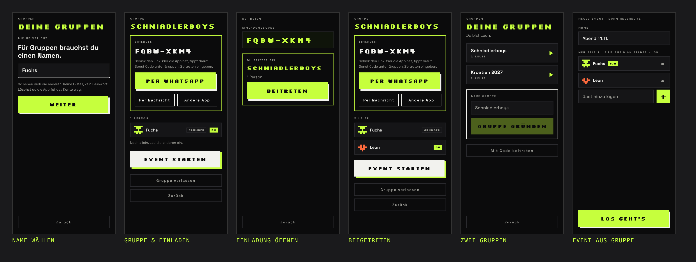

# Auf 3

Das Quotenspiel als App für iOS und Android. Jemand quotet dich, du setzt die Quote zwischen 2 und 50, beide tippen geheim eine Zahl, auf 3 wird aufgedeckt. Gleiche Zahl: du musst. Daneben: Gegenquote mit gleicher Range.


## Stand

| Bereich | Status |
|---|---|
| Spielregeln, Schuldenbuch, Ranglisten, Avatare, Kommentare | fertig, getestet |
| Bar-Modus mit einem Handy, offline, gespeichert auf dem Gerät | fertig, im Browser durchgespielt |
| Knapp-Moment, Rivalität, Serien, Titel, Chronik, vier Töne, Haptik-Crescendo, Reveal-Animationen | gebaut, Haptik und Ton am Gerät noch nicht geprüft |
| Haptik, Sounds, Umdreh-Erkennung | gebaut, auf echten Geräten noch nicht getestet |
| Server-Schema für den Live-Modus mit zwei Handys | fertig, gegen Postgres getestet |
| Gruppen: anonymes Konto mit Namen, gründen, per WhatsApp oder Nachricht einladen, per Link oder Code beitreten, mehrere Gruppen, Event aus Gruppe starten | fertig, mit zwei Nutzern gegen lokales Supabase getestet |
| Ergebnisse zwischen Handys teilen, Live-Modus mit zwei Handys | offen |

## Voraussetzungen

Node.js 22.13 oder neuer. Expo SDK 58 läuft mit älteren Versionen nicht.

## Befehle

```bash
npm install
npm run web          # im Browser starten
npm start            # Expo-Dev-Server für Handy (Development Build nötig, siehe unten)
npm test             # Spiellogik (Vitest)
npm run test:db      # Datenbank-Funktionen und RLS gegen ein Wegwerf-Postgres 16
npm run test:db:supabase  # dieselben Tests gegen das offizielle Supabase-Image (Docker)
npm run test:e2e     # kompletter Abend im Browser, Screenshots in e2e/screenshots
npm run test:e2e:gruppen  # zwei Nutzer: Gruppe, Einladung, Beitritt, braucht npm run db:start
npm run db:types     # TypeScript-Typen aus dem lokalen Supabase-Schema neu erzeugen
npm run typecheck
npx expo lint
```

Expo Go aus dem App Store unterstützt nur bis SDK 54, diese App nutzt SDK 58. Aufs iPhone kommt sie deshalb als eigener Build:

- **Kostenlos mit Mac und Xcode:** Anleitung in [docs/ios-lokal.md](docs/ios-lokal.md). Läuft 7 Tage pro Installation.
- **Mit Apple-Mitgliedschaft:** Expo Build verteilt die App per Link, siehe Profile in `eas.json`.

## Gruppen und Supabase

Gruppen laufen über Supabase mit anonymer Anmeldung: Name statt E-Mail. Im Supabase-Projekt muss dafür unter Authentication „Allow anonymous sign-ins“ eingeschaltet sein. Löscht jemand die App, ist sein Konto weg.

Einladungen gehen als Text mit `auf3://join?code=…` und dem Code raus. WhatsApp macht eigene App-Links vermutlich nicht anklickbar, deshalb steht der Code immer dabei.

Lokales Supabase für Tests, braucht Docker:

```bash
npm run db:start
```

Die Konfiguration dafür liegt in `e2e/supabase`, nicht in `supabase/`, damit sie nie als Konfiguration des Live-Projekts gelesen wird.



## Aufbau

```
src/domain/     Spielregeln als reine Funktionen. Keine Abhängigkeit zu React.
src/feedback/   Haptik, Sound, Umdreh-Erkennung
src/state/      Lokaler Spielstand (AsyncStorage)
src/ui/         Tokens und Komponenten: Display, Keypad, BlockButton, Receipt, PixelAvatar, RangeSlider
src/app/        Screens (Expo Router)
supabase/       Migration und SQL-Tests für den Live-Modus
scripts/        Erzeugt Sounds und Icons per Code, keine fremden Assets
e2e/            Browser-Durchlauf mit Playwright
```

Grundsätze:

- **Eine Regelquelle.** `src/domain/rules.ts` und die Postgres-Funktionen in `supabase/migrations` implementieren dieselbe Zustandsmaschine. Wer eine Regel ändert, ändert beide und beide Testsuites.
- **Clients schreiben nie direkt.** Im Live-Modus laufen alle Spielzüge über Datenbankfunktionen. Die Zahl des Gegenübers ist per Row Level Security bis zum Reveal unsichtbar.
- **Gimmicks erst nach dem Pick.** Quote stellen, Range setzen, Zahl tippen sind schnell und nüchtern. Countdown, Reveal und Beleg dürfen angeben.

## Dokumente

- [Produkt- und Architekturplan](docs/plan.md) mit UI-Konzept und Umsetzungsstand
- [Kostenlos aufs iPhone mit Xcode](docs/ios-lokal.md)
- [Stand, Entscheidungen, offene Punkte](docs/stand.md)
- [Plan Bar-Modus 2](docs/plan-bar-modus.md), Phase A freigegeben
- [Sog: Vorschläge für Bar-Modus und App-Version](docs/plan-sog.md), Entwurf

## Bekannte Grenzen

- Die Umdreh-Erkennung nutzt das unterschiedliche Vorzeichen der Z-Achse auf iOS und Android. Das ist aus dem Quellcode von `expo-sensors` abgeleitet und muss auf echten Geräten bestätigt werden.
- Teilen als Bild funktioniert nur nativ. Im Browser wird Text geteilt.
- Der Verfall offener Quoten im Live-Modus braucht einen `pg_cron`-Job, siehe Kommentar in der Migration.
